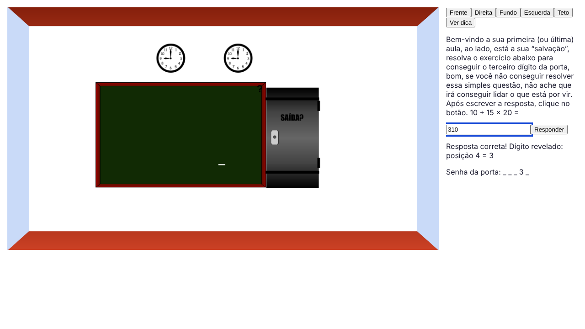
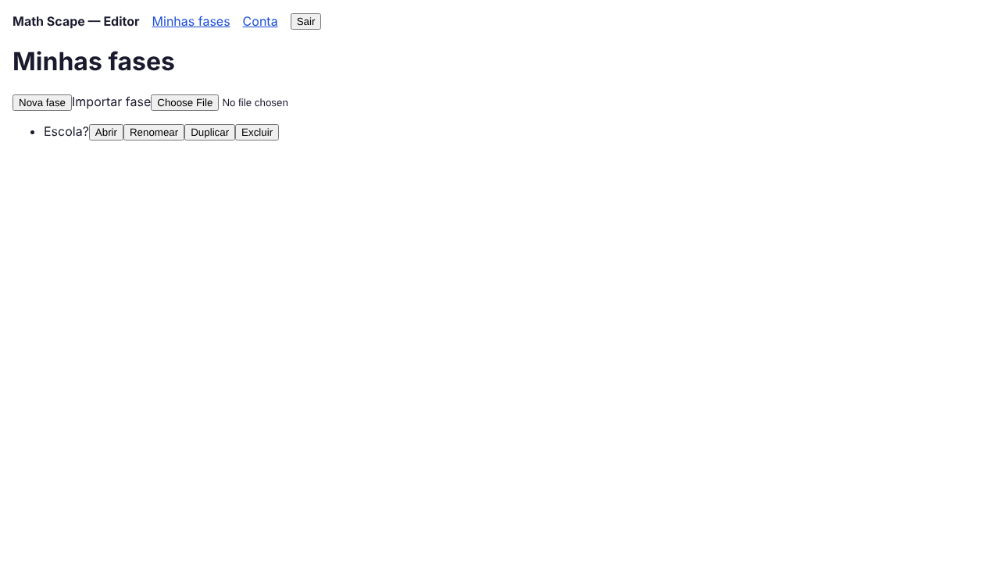
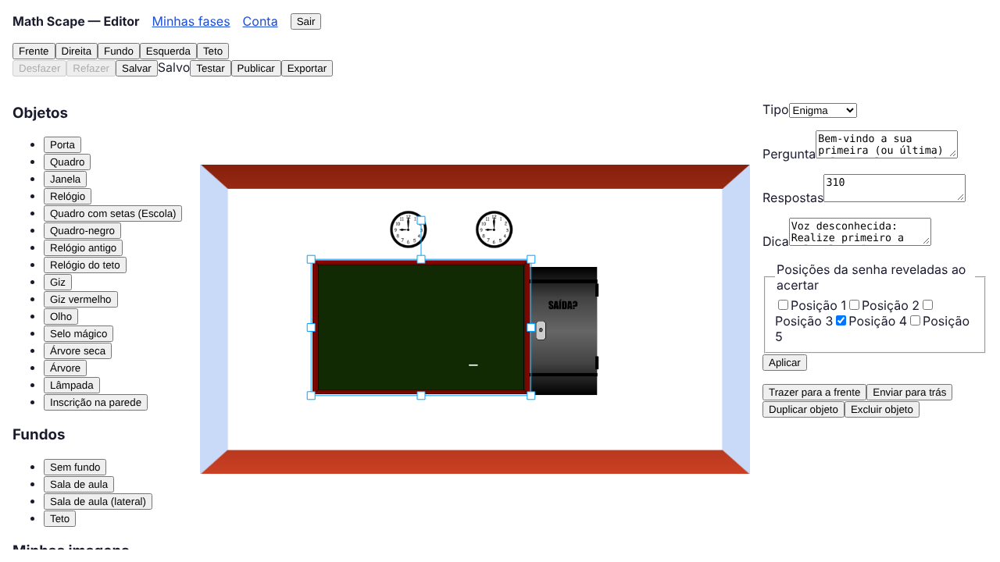

# Manual do usuário — Math Scape

O Math Scape é um jogo de fuga com enigmas de matemática. Cada fase é uma sala com 5 paredes (frente, direita, fundo, esquerda e teto). Quem joga clica nos objetos, resolve os enigmas e junta os dígitos da senha da porta. Quem cria monta a sala no **Editor** arrastando objetos, sem escrever código.

- **Jogar:** abra o endereço do jogo (o *Player*). Não precisa de conta.
- **Criar:** no Player, use "Criar fases no editor", ou abra direto o endereço do *Editor*. Precisa de conta.

Use um computador com Chrome, Edge ou Firefox atualizados e janela de pelo menos 1280x720. Abaixo disso, aparece um aviso e algumas partes podem não caber.

## 1. Jogar uma fase

1. Na tela inicial, clique em **Escolher fase** e depois no nome da fase.
2. A sala aparece à esquerda. À direita ficam os botões das paredes: **Frente**, **Direita**, **Fundo**, **Esquerda** e **Teto**.
3. Clique nos objetos da sala:
   - **objeto de enfeite:** nada acontece;
   - **objeto com fala:** o texto aparece à direita;
   - **enigma:** a pergunta aparece com um campo. Escreva a resposta e aperte **Responder** ou Enter. Ao acertar, a mensagem mostra qual dígito foi revelado e em que posição, e a linha **Senha da porta** vai sendo preenchida (por exemplo `_ _ _ 3 _`);
   - **porta:** pede a senha completa. Com a senha certa, a porta abre e a fase termina.
4. Enigmas com dica mostram um **?** no objeto e o botão **Ver dica**.
5. A resposta é comparada pelo número: `80`, ` 80 `, `080` e `80,0` valem o mesmo. Texto sem número não vale.
6. Errar muitas vezes seguidas bloqueia a resposta por alguns minutos ("Muitas tentativas, aguarde N s").

## 2. Criar a sua conta

No Editor, preencha **Cadastrar** com nome, e-mail e senha. Da próxima vez, use **Entrar**. O sistema guarda só esses três dados, e a senha é gravada cifrada.

Para apagar tudo, vá em **Conta** → **Excluir conta** → **Confirmar**. Isso apaga a conta, as fases e as imagens enviadas, e não tem volta.

## 3. Minhas fases

| Botão | O que faz |
|---|---|
| **Nova fase** | Pede o **Título** e cria uma sala vazia, já com uma porta. |
| **Abrir** | Abre a fase para editar. |
| **Renomear** | Troca o título. |
| **Duplicar** | Cria uma cópia (não publicada). |
| **Excluir** | Apaga a fase. Se ela estiver publicada, pede confirmação, e ela sai da lista dos jogadores. **Ctrl+Z não desfaz.** |
| **Importar fase** | Abre um arquivo `.json` exportado do Math Scape e cria uma fase nova com ele. Arquivo fora do formato é recusado e nada é gravado. |

## 4. Montar a sala

- **Paredes:** os botões **Frente**, **Direita**, **Fundo**, **Esquerda** e **Teto** no alto trocam a parede em edição. Cada parede tem os seus próprios objetos.
- **Colocar objetos:** arraste um item de **Objetos** (porta, quadro, janela, relógio, giz…) até a sala, ou clique nele para pô-lo na parede ativa.
- **Fundo da parede:** escolha em **Fundos** (ou **Sem fundo**).
- **Imagens suas:** **Enviar imagem** aceita PNG, JPG ou WebP de até 5 MB. A imagem vai para **Minhas imagens**, com os botões **Usar como objeto** e **Usar como fundo**.
- **Mover, aumentar e girar:** clique no objeto. Arraste para mover, puxe os quadradinhos dos cantos para mudar o tamanho e a alça de cima para girar.
- **Sobreposição:** com o objeto selecionado, use **Trazer para a frente** ou **Enviar para trás**. **Duplicar objeto** cria uma cópia na mesma parede, e **Excluir objeto** remove (as teclas Delete e Backspace também).
- **Desfazer e refazer:** botões **Desfazer** e **Refazer**, ou Ctrl+Z e Ctrl+Y.

## 5. Fazer o jogo funcionar

Clique num objeto e escolha o **Tipo** no painel da direita. Depois de preencher, clique em **Aplicar**.

| Tipo | Campos | No jogo |
|---|---|---|
| **Decoração** | nenhum | Enfeite: não reage ao clique. |
| **Fala** | **Texto** | Mostra o texto. |
| **Enigma** | **Pergunta**; **Respostas** (só números, uma por linha; qualquer uma vale); **Dica** (opcional); **Posições da senha reveladas ao acertar** | Pede a resposta. Ao acertar, revela os dígitos da senha nas posições marcadas. Um enigma pode não revelar nenhuma. |
| **Porta** | nenhum | Pede a senha. |

A **senha da porta** é da fase inteira: clique numa área vazia da sala para ver **Propriedades da fase** e preencha **Senha**, com 4 a 8 algarismos (começa com 5). Cada posição da senha precisa ser revelada por algum enigma; sem isso, a fase não pode ser publicada.

## 6. Salvar, testar e publicar

- **Salvar:** o Editor salva sozinho a cada 30 segundos e ao trocar de parede. O botão **Salvar** grava na hora. Ao lado aparece o estado: **Salvo**, **Alterações pendentes**, **Salvando…** ou **Erro ao salvar**. Se a fase foi alterada em outra janela, aparece **Conflito**: use **Recarregar a fase**.
- **Testar:** joga a fase dentro do Editor, com as mesmas regras do jogador. **Sair do teste** volta à edição, com a fase como estava.
- **Publicar:** coloca a fase em **Escolher fase** para qualquer pessoa jogar. Se faltar enigma para alguma posição da senha, o Editor mostra **Posições da senha sem enigma** com os números que faltam.
- **Alterar uma fase publicada:** quem joga continua vendo a versão publicada. O Editor avisa **Alterações não publicadas**, e **Publicar de novo** troca a versão do jogador.
- **Exportar:** baixa a fase num arquivo `.json`, com as imagens dentro, para guardar ou importar em outra conta.

## 7. Problemas comuns

| O que aparece | O que fazer |
|---|---|
| "Não foi possível falar com o servidor. Tente de novo." | Confira a internet e tente de novo. Se continuar, avise a equipe (seção 8). |
| A publicação é recusada com uma lista de posições | Crie ou ajuste enigmas para revelar essas posições, ou diminua a senha. |
| A imagem não é aceita | Use PNG, JPG ou WebP com até 5 MB. |
| "Muitas tentativas, aguarde N s" | Espere o tempo indicado. Hoje esse limite pode ser disparado por outras pessoas jogando a mesma fase (defeito DEF-10, em correção). |
| A fase "Escola?" não aparece | A fase original é carregada pela equipe. Avise (seção 8). |

## 8. Encontrou um erro?

Abra uma issue no GitHub do projeto com o título começando por `[bug]`. Descreva o que fez, o que esperava e o que aconteceu, e diga o navegador e o endereço da página. Se puder, anexe um print. Não coloque senha nem dado pessoal. O fluxo de triagem está no [plano de manutenção](plano-manutencao.md).
